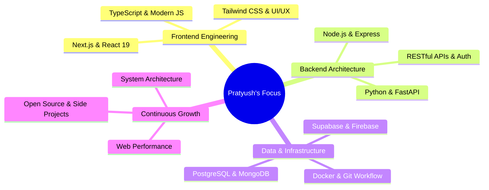

<div align="center">
  
</div>

<div align="center">
  
### 🚀 Building Fast, Scalable Web Applications From Frontend To APIs

[](https://pratyush-kumar.vercel.app/)
[](https://www.linkedin.com/in/pratyush-kumar-2059071b6/)
[](https://www.behance.net/pratyushkumar8)
[](https://github.com/Glitchier)
[](mailto:pratyushkumar072@gmail.com)

</div>

<br>

<div align="center">
  
</div>

<br>

## 👨‍💻 About Me

<table>
<tr>
<td width="50%">

```yaml
role: "Full-Stack Web Developer"
focus: "Modern Web Architecture & UI/UX"
location: "India 🇮🇳"

core_stack:
  - Next.js & React
  - TypeScript & JavaScript
  - Python & FastAPI
  - PostgreSQL & MongoDB

currently_building:
  - High-Performance Web Applications
  - Responsive Frontend Architectures
  - Scalable RESTful Services & APIs

passions:
  - Clean Architecture & Web Performance
  - Elegant & Accessible UI/UX Engineering
  - Open Source & Modern Web Tooling

motto: "From the interface to the APIs behind it"
```

</td>
<td width="50%">


</td>
</tr>
</table>

<br>

## 🛠️ Technology Stack

<details open>
<summary><b>🚀 Languages & Frameworks</b></summary>
<br>

<p align="left">
  
</p>

</details>

<details open>
<summary><b>💾 Databases & Cloud</b></summary>
<br>

<p align="left">
  
</p>

</details>

<details open>
<summary><b>🛠️ Tools & Platforms</b></summary>
<br>

<p align="left">
  
</p>

</details>

<details open>
<summary><b>🎨 Design & Creative</b></summary>
<br>

<p align="left">
  
  
</p>

</details>

<br>

## 🚀 Featured Projects

<table>
<tr>
<td width="50%">

### 🛍️ [Forever E-Commerce](https://github.com/Glitchier/forever_e-commerce_app)

Full-stack e-commerce store with product management, shopping cart, and online payments.

**Highlights:**
- 🛒 Full product catalog with dynamic filtering
- 💳 Integrated Stripe & Razorpay payment gateways
- 🔐 Secure authentication & order tracking
- 📱 Fully responsive mobile-first interface

**Tech:** `React` `TypeScript` `Express` `MongoDB`

[Live Demo](https://forever-e-commerce-ivory.vercel.app/) · [GitHub Repo](https://github.com/Glitchier/forever_e-commerce_app)

</td>
<td width="50%">

### ⛅ [Frost Weather](https://github.com/Glitchier/Frost_Weather)

Real-time weather application with multi-day forecasts and responsive weather charts.

**Highlights:**
- 🌡️ Real-time weather conditions & environmental metrics
- 📊 Interactive temperature & precipitation charts
- 🌍 Multi-day forecasts with global location search
- ⚡ Fast client-side data caching & instant updates

**Tech:** `React` `TypeScript` `Recharts` `Weather API`

[Live Demo](https://frost-weather.vercel.app/) · [GitHub Repo](https://github.com/Glitchier/Frost_Weather)

</td>
</tr>
<tr>
<td width="50%">

### 🏡 [Ghar Naksha Wala](https://github.com/Glitchier/Ghar_Naksha_Wala)

Modern architectural showcase & house-planning web app with interactive service catalog.

**Highlights:**
- 📐 Showcase of architectural plans & structural layouts
- 🎨 Polished design with smooth motion transitions
- 📱 Optimized for all screen sizes & touch devices
- 💬 Direct inquiry & consultation workflows

**Tech:** `React` `TypeScript` `shadcn/ui` `Motion`

[Live Demo](https://ghar-naksha-wala.vercel.app/) · [GitHub Repo](https://github.com/Glitchier/Ghar_Naksha_Wala)

</td>
<td width="50%">

### 🌐 [Personal Portfolio](https://pratyush-kumar.vercel.app/)

Minimalist, high-performance developer portfolio built with Next.js 16 and React 19.

**Highlights:**
- ⚡ 100% prerendered routes & instant load times
- 🎨 Light & dark themes with circular view transitions
- ⌨️ Command palette menu (`⌘K` / `Ctrl K`)
- 🔍 Optimized SEO, JSON-LD, & OpenGraph cards

**Tech:** `Next.js 16` `React 19` `Tailwind v4` `Motion`

[Live Demo](https://pratyush-kumar.vercel.app/) · [GitHub Profile](https://github.com/Glitchier)

</td>
</tr>
</table>

<br>

## 📈 GitHub Statistics

<div align="center">
  
  
</div>

<div align="center">
  
</div>

<br>

## 💡 What I'm Up To



<br>

## 📫 Let's Connect

<div align="center">

**💬 Open to exciting full-stack opportunities, collaborations, and discussions!**

[](mailto:pratyushkumar072@gmail.com)
[](https://www.linkedin.com/in/pratyush-kumar-2059071b6/)
[](https://pratyush-kumar.vercel.app/)
[](https://www.behance.net/pratyushkumar8)

</div>

<br>

<div align="center">
  


</div>

<br>

<div align="center">
  
</div>

<br>

<div align="center">
  
</div>

<div align="center">
  <sub>⚡ <strong>Crafting Clean Code & Scalable Web Apps — One Commit at a Time</strong> ⚡</sub>
</div>
